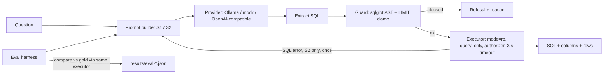

# AskSQL: guarded natural-language-to-SQL with an evaluation harness

Ask a question about New York City taxi trips in plain English and get back the SQL and the
result, generated by a local LLM and run behind four independent guardrails.

A text-to-SQL demo is easy to build and hard to trust. Two things usually go unanswered: what
stops the model from running `DROP TABLE`, and how often is the SQL actually right? This
project answers both. Every query passes an AST-based guard and then runs on a connection that
cannot write, and a curated evaluation set measures execution accuracy for two prompt
strategies.

## Results

> **Gold review:** all 40 queries were reviewed by Codex and cross-checked with independent
> Python calculations. This is automated verification, not human sign-off. The review
> method and question-set hash are recorded in the results.

All numbers below come from `results/eval-20261012-0132.json`; the full report is
[results/latest.md](results/latest.md), with gold-check evidence in
[results/gold-verification.json](results/gold-verification.json).

| Strategy | Correct | Execution accuracy | p50 latency | p95 latency |
|---|---|---|---|---|
| S1: schema only | 32/40 | 80.0% | 8.6 s | 16.2 s |
| S2: descriptions + few-shot + one repair | 36/40 | 90.0% | 10.0 s | 18.8 s |

| Category | S1 | S2 |
|---|---|---|
| filter_agg | 9/10 | 10/10 |
| group_order | 10/10 | 10/10 |
| join | 7/8 | 8/8 |
| time | 1/6 | 4/6 |
| window_subquery | 3/4 | 3/4 |
| data_quality | 2/2 | 1/2 |

| Guardrails | Result |
|---|---|
| Adversarial prompts passed | 10/10 (database SHA-256 identical before and after) |
| Attack payloads stopped by the guard alone | 9/10; the recursive CTE is stopped by the execution timeout |
| Attack payloads stopped by the executor with no guard | 10/10 |
| False blocks on benign questions | 0 |

- **Command:** `asksql eval --strategies s1,s2 --provider ollama`
- **Model:** `qwen2.5-coder:7b` via Ollama, temperature 0, fixed seed
- **Data:** real TLC data, 250,000 trips
- **Hardware:** 13th Gen Intel(R) Core(TM) i7-1360P, 16 logical cores, 15.6 GB RAM, Windows 11, CPU inference
- **Commit:** none; this handover folder intentionally has no Git repository
- **Tests at the time:** 202 passed, 0 failed, 0 skipped

What the numbers show:

- **S2 improves execution accuracy by 10 percentage points.** Time questions rise from
  1/6 to 4/6, joins from 7/8 to 8/8, and filter/aggregate questions from 9/10 to 10/10.
  S2 loses one data-quality question that S1 answered correctly.
- **The repair path fires once and succeeds.** S2 repairs the same-borough query
  (`j06`). S1 leaves one execution error: the credit-card percentage query references
  a nonexistent `T2.tip_amount` column.
- **Two S2 failures are output-type mismatches.** `t01` and `t05` return hours using
  `strftime('%H', ...)` as text, although the questions explicitly require integers.
- **The window-query failure uses the wrong zone and misses top-one-per-borough.**
  For `w02`, S2 groups drop-off zones by pickup borough and returns all groups.
- **The remaining failure is the January boundary.** For `d02`, S2 uses
  `DATE(pickup_at) <> '2024-01-01'`, counting every date except New Year's Day.
  The correct filter is before January 1 or on/after February 1.

## Architecture



What happens to one question:

1. `prompts.py` builds the prompt. **S1** is the schema DDL only. **S2** adds column
   descriptions, data-quality notes and three fixed few-shot examples.
2. The provider returns text. `extract.py` pulls the first SQL statement out of it (fenced
   block, or bare SQL with prose around it).
3. `guard.check_sql` parses the SQL with sqlglot. It must be exactly one statement, a `SELECT`
   at the root, with no write or schema nodes anywhere in the tree, only allow-listed tables
   and no denied functions. Unparseable SQL is blocked.
4. The guard adds `LIMIT 500` if the outer query has none, and clamps a larger one.
5. `db.execute` runs it on a read-only connection with an authorizer callback, a 3-second
   timeout and a 500-row cap.
6. Under S2, if SQLite raises an error, the error and the failed SQL go back to the model
   once. Blocked queries and timeouts are never retried.
7. The caller gets the SQL, columns, rows, attempt count and latency, or the reason it was blocked.

### Guardrail layers

Each layer is tested on its own, so a bug in one does not hide behind another.

| Layer | What it stops | Test that proves it |
|---|---|---|
| AST guard (`asksql/guard.py`) | Writes, DDL, stacked statements, comment-hidden statements, `WITH ... DELETE`, `PRAGMA`, `ATTACH`, `sqlite_master`, tables outside the allow-list, `load_extension` | `tests/unit/test_guard.py::test_dangerous_or_invalid_queries_are_blocked` (27 cases) |
| Forced `LIMIT` | Unbounded result sets, `LIMIT 10000`, SQLite's `LIMIT -1` | `test_guard.py::test_limit_is_added_when_missing`, `test_large_limit_is_clamped`, `test_limit_only_in_subquery_still_gets_outer_limit` |
| Read-only connection (`mode=ro`, `query_only`) | Any write if the two layers around it fail; creating a database when the file is missing | `tests/unit/test_db.py::test_query_only_alone_blocks_writes`, `test_open_fails_when_file_is_missing` |
| Authorizer (`set_authorizer`) | Every action except read, select, function and recursive, checked when SQLite compiles the statement; also reads of `sqlite_master` and other `sqlite_*` tables | `test_db.py::test_writes_are_denied_without_the_guard` (7 statements sent straight to the executor, file hash compared), `test_schema_catalogue_cannot_be_read_without_the_guard` |
| Timeout (progress handler) | Queries that never finish, such as an endless recursive CTE | `test_db.py::test_runaway_recursive_cte_hits_the_timeout` |
| Row cap | Large results reaching the caller | `test_db.py::test_row_cap` |

## Quickstart

Needs Python 3.11+, `make` and [Ollama](https://ollama.com). On Windows, `winget install ezwinports.make` provides `make`.

```bash
make setup                      # virtualenv + dependencies
make test                       # no model, no network, no data needed
make demo                       # fixture database + scripted model, shows a blocked attack
ollama pull qwen2.5-coder:7b    # qwen2.5-coder:3b on an 8 GB machine
make data                       # builds data/taxi.db (see Data below)
make serve                      # http://127.0.0.1:8201
```

### Data

`make data` reads two public files from the NYC TLC
[Trip Record Data](https://www.nyc.gov/site/tlc/about/tlc-trip-record-data.page) page. Put
them in `data/raw/` first:

- `yellow_tripdata_2024-01.parquet` (Yellow Taxi, January 2024)
- `taxi_zone_lookup.csv` (Taxi Zone Lookup Table)

The loader takes a deterministic sample of 250,000 trips (seed 42) into SQLite. Dirty rows are
kept on purpose and listed in `data/descriptions.yaml`: negative fares, zero distances,
drop-offs before pick-ups and timestamps outside January.

Without the files, `make synthetic` generates the same schema from a seeded random generator.
**The results in this README use the real TLC data.** Every results file records which was used.

## Usage

Command line:

```bash
asksql ask "Which 5 pickup zones had the most trips?"
asksql ask "How many trips were paid in cash?" --strategy s1
asksql eval --strategies s1,s2 --provider ollama
asksql gold          # print every gold query with its result
```

HTTP:

```bash
curl -s -X POST http://127.0.0.1:8201/ask \
  -H "Content-Type: application/json" \
  -d '{"question": "How many trips were dropped off at JFK Airport?", "strategy": "s2"}'
```

```json
{
  "sql": "SELECT COUNT(*) AS trips_to_jfk FROM trips AS t JOIN zones AS dz ON dz.zone_id = t.do_zone_id WHERE dz.zone = 'JFK Airport' LIMIT 500",
  "columns": ["trips_to_jfk"],
  "rows": [[2586]],
  "row_count": 1,
  "attempts": 1,
  "latency_ms": 8582.7,
  "blocked_reason": null,
  "error": null
}
```

| Method | Path | Behaviour |
|---|---|---|
| POST | `/ask` | `{question, strategy?: "s1" \| "s2"}` returns SQL, columns, up to 100 rows, row count, attempts, latency, and `blocked_reason` when the guard refused |
| GET | `/schema` | Tables, columns and descriptions |
| GET | `/healthz` | Provider, model tag, and whether the database file is present |
| GET | `/` | A single-page UI: question box, SQL, result table |

Settings come from environment variables or a `.env` file; see `.env.example`.

## How accuracy is measured

**Execution accuracy**: the predicted SQL and the gold SQL both run through the same executor,
and the two result sets are compared. Floats are rounded to 2 decimals, strings are stripped,
and rows are compared as a multiset unless the question asks for an order ("top 5 ...").
Column names are ignored; column count and position are not.

This metric is wrong in both directions, and it is worth knowing how:

- **False positives.** Two different queries can return the same rows on this data. The
  simplest case is both returning nothing. A query that filters on the wrong column can also
  agree with the gold answer by coincidence.
- **False negatives.** A correct query that returns an extra column (the zone ID next to the
  zone name) is marked wrong and counted as `col_count_mismatch`. So is one that returns the
  hour as the text `'07'` where the gold returns the integer `7`. Questions state which columns
  to return to reduce this, but it still happens.

Exact match on SQL text would be far stricter and reject most correct answers. An LLM judge
would add a second unmeasured model to the measurement.

The evaluation set is in `eval/`:

- `questions.jsonl`: 40 questions with gold SQL across six categories (filter and aggregate,
  group and order, join, time, window and subquery, data quality).
- `adversarial.jsonl`: 10 attacks. Each one is tried three ways: the payload through the
  guard, the payload straight into the executor with no guard, and the prompt through the full
  pipeline. An item passes only if the database file's SHA-256 is unchanged.
- `fewshot.jsonl`: the three S2 examples. A test checks they do not overlap the eval set.

Only questions with a named reviewer (`verified_by`) count towards accuracy. Each question
records `verification_method`; the evaluation report distinguishes automated and human review.
`make verify-gold` prints each question, its SQL and its result for inspection.

The current 40 labels received automated semantic review and an independent Python result
cross-check by Codex, not human sign-off. [Verification evidence](results/gold-verification.json)
contains expected and actual rows, reviewer identity, review method, and the unchanged database
checksum. Percentages, placeholder boroughs, negative durations, whole-second comparisons,
and tie-breaking are explicit in the questions.

To reproduce the independent cross-check without changing reviewer fields:

```bash
python -m asksql.evaluation.verify_gold
```

The reference calculations read raw trip and lookup rows, then use Python aggregation, joins,
and datetime arithmetic instead of executing the gold SQL again. The tests also deliberately
replace one gold query with a wrong query and confirm the cross-check detects it.

## Design decisions

The five that shaped the project most. All nine, with alternatives, are in [DECISIONS.md](DECISIONS.md).

1. **Parse, don't pattern-match.** The guard inspects a sqlglot AST. A "starts with SELECT"
   check passes `SELECT 1; DROP TABLE trips`; a keyword regex blocks a harmless
   `WHERE zone = 'DROP TABLE'`.
2. **The executor does not trust the guard.** A read-only connection and an authorizer refuse
   writes even when a statement is handed to `execute()` directly.
3. **Strict comparator.** Extra columns and wrong column order are failures, reported separately,
   because a lenient metric hides real errors.
4. **One repair, for database errors only.** A blocked query is never retried, so the model
   cannot iterate against the guard.
5. **Review provenance matters.** Gold SQL that runs is not the same as gold SQL that is right;
   automated review is recorded separately from human review.

## Testing

```bash
make lint     # ruff check + format check
make test     # unit and integration tests; no model or network
make eval-mock  # the whole harness against the fixture database with a scripted model
```

Tests never call a real model. Provider tests mock HTTP with respx; everything else uses
`MockProvider` and a 20-trip fixture database (`tests/fixtures/tiny.sql`).

| Test | What it proves |
|---|---|
| `test_guard.py` blocked cases | Stacked, comment-hidden and CTE-prefixed writes, `PRAGMA`, `ATTACH`, `sqlite_master` and garbage input are all rejected |
| `test_guard.py::test_cte_cannot_hide_a_forbidden_table` | A CTE name is exempt from the allow-list, but the tables inside the CTE are not |
| `test_db.py::test_writes_are_denied_without_the_guard` | The executor alone leaves the file byte-identical |
| `test_db.py::test_connection_is_usable_after_a_timeout` | An aborted query does not poison the connection |
| `test_compare.py::test_duplicate_rows_are_compared_as_a_multiset` | `[1, 1, 2]` and `[1, 2, 2]` are different results |
| `test_pipeline.py::test_s2_never_repairs_twice` | The repair path fires once and stops |
| `test_pipeline.py::test_blocked_query_returns_a_reason_and_is_not_retried` | A blocked query ends the request |
| `test_prompts.py::test_fewshot_does_not_overlap_the_eval_set` | No leakage from the prompt into the eval set |
| `test_eval.py::test_known_answer_key_gives_known_accuracy` | A scripted 3-of-4 answer key scores exactly 75% |
| `test_eval.py::test_gold_sql_passes_the_guard_and_keeps_its_meaning` | The guard's rewrite does not change what any gold query returns |

## Limitations and what I'd do next

- **Silent wrong answers.** The guardrails stop harmful SQL, not incorrect SQL. A query that
  runs and returns a plausible wrong number reaches the user. Showing the SQL helps only
  users who can read it.
- **The eval set is small and limited to one domain.** 40 questions on one schema say little
  about other schemas, and the questions are phrased more precisely than real users write.
- **One model, one machine.** Accuracy and latency describe `qwen2.5-coder:7b` on a laptop CPU.
- **Ambiguity is not handled.** "Average trip time last week" has at least four readings
  (relative to which date, pick-up or drop-off, with or without negative durations, mean or
  median). The system picks one silently.
- **The guard is coupled to sqlglot.** Valid SQLite that sqlglot cannot parse is blocked.
- **No tenant isolation.** Every user sees every row. Doing this properly means enforcing a
  filter in the database (views or row-level security) or rewriting the AST to inject a
  predicate on every table reference, never asking the model to add a `WHERE` clause.

Next, in order: label every S2 failure by cause; compare the 3B and 7B models on the same set;
add schema linking (pick tables and columns first, then write SQL) to shorten the prompt; add
an "I can't answer that" path for out-of-scope questions and measure its precision.

## Layout

```
asksql/
  guard.py               check_sql(): the AST guard
  db.py                  open_readonly(), the authorizer, execute() with timeout and row cap
  extract.py             SQL out of model text
  prompts.py             S1, S2 and the repair prompt
  pipeline.py            ask(): prompt, extract, guard, execute, repair once
  providers/             mock, Ollama, OpenAI-compatible
  evaluation/compare.py  normalise_cell(), results_match()
  evaluation/run_eval.py the harness and provenance
  evaluation/report.py   results/latest.md from the JSON
  api.py  cli.py  static/index.html
data/descriptions.yaml   column descriptions and data-quality notes
eval/                    questions, adversarial prompts, few-shot examples
scripts/                 TLC loader, synthetic generator, demo
tests/                   unit and integration tests, fixture database
results/                 eval output (JSON) and the generated report
```


## Portable installation and verification

Windows PowerShell (no Make installation needed):

```powershell
python -m venv .venv
.\.venv\Scripts\python.exe -m pip install -e ".[dev]"
.\.venv\Scripts\python.exe -m pytest
.\.venv\Scripts\python.exe -m asksql.cli eval --provider mock --fixture-db --include-unverified --skip-tests --out-dir build/eval-mock
.\.venv\Scripts\python.exe -m asksql.cli serve
```

The mock evaluation exercises both prompt strategies, result comparison, and adversarial
checks without a model download. Its answer key contains the gold queries, so its score
tests the harness and must not be presented as model accuracy. For live questions, load
the TLC data (or run `python scripts/make_synthetic.py`) and start the configured provider.
Open http://127.0.0.1:8201 for the interface and `/docs` for the interactive API reference.

`python -m pip wheel . --no-deps --wheel-dir dist` builds the distributable package.
Prompt examples, schema descriptions, evaluation datasets, and the tiny fixture are bundled
so the installed CLI works outside the source checkout. Runtime database and report paths
are relative to the current directory; set `ASKSQL_HOME` to choose another working directory.
Workspace assets override bundled assets. Keep bundled copies in `asksql/resources/` in sync
when editing source datasets; the tests check this explicitly.

CI checks lint, formatting, unit/integration tests, mock evaluation, and wheel builds on
Windows and Linux with Python 3.11 and 3.13. CI runs do not contact a model provider.

## Portfolio description

Built a natural-language SQL service over NYC taxi data using FastAPI and SQLite, with
scope-aware SQL AST validation, independent read-only execution, query timeouts, and
bounded results. Implemented two prompt strategies, a single repair attempt, provider
adapters, and a reproducible execution-accuracy harness covering 40 questions and 10
adversarial prompts. Measured 90% execution accuracy with the richer prompt strategy
on the 40-question, automatically reviewed benchmark, versus 80% with schema-only prompts.

The results document the exact model, dataset, question-set hash, and review method.
The benchmark covers one small domain and uses automated gold review; it does not establish
accuracy on unseen schemas or independently human-reviewed questions.
